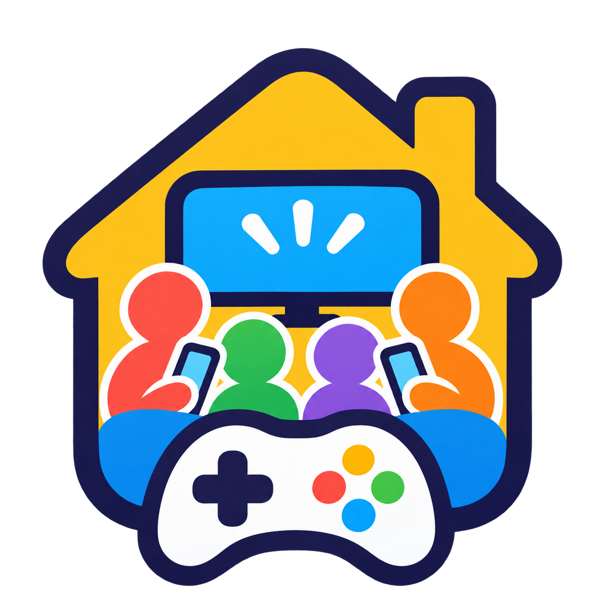

<p align="center">
  
</p>

# Game Center · Centro de juegos familiar

**Game Center es un centro de juegos multijugador para jugar en familia o con amigos en casa.** La televisión muestra la partida y cada persona participa desde el navegador de su móvil, conectado a la misma red local. Escanea el código QR del centro, elige un juego y comparte la diversión en una pantalla grande.

Una aplicación web de juegos para reuniones familiares, fiestas y tardes de sofá, alojada en tu propio ordenador con Docker (*self-hosted family party game hub*). Su catálogo puede ampliarse con nuevos juegos.

- **Televisión y móviles:** una pantalla compartida y un móvil por jugador, sin instalar una aplicación nativa para jugar.
- **Acceso por QR:** abre el centro desde otro dispositivo de la red doméstica.
- **En tu propia red:** el centro y los juegos se ejecutan en contenedores Docker independientes.

## Juegos disponibles

1. [Bingo en familia](games/bingo/README.md).

## Instalación paso a paso

Solo tienes que instalar el centro en **un ordenador de casa**. La televisión y los móviles se conectan desde su navegador; no necesitan Docker ni instalar el juego.

### 1. Prepara lo necesario

- Un ordenador con **Windows o Linux**, conectado a Internet durante la instalación.
- Una televisión con navegador, o una pantalla conectada al ordenador, y un móvil por jugador.
- Todos los dispositivos conectados a la **misma red de casa**, por Wi-Fi o cable. El ordenador debe permanecer encendido mientras jugáis.

### 2. Descarga el proyecto

Descarga los archivos de este repositorio como **ZIP** y extrae su contenido en una carpeta del ordenador. En Windows, haz clic derecho sobre el ZIP y elige **Extraer todo**. No ejecutes los comandos desde el ZIP sin extraerlo.

Abre la carpeta extraída: debes ver los archivos **`compose.yaml`** y **`README.md`**. Esa es la carpeta que utilizarás en los siguientes pasos.

### 3. Instala Docker

Docker es el programa que permite ejecutar Game Center y sus juegos. **No necesitas instalar Node.js ni npm.** Elige las instrucciones de tu sistema:

**Windows**

1. Descarga e instala Docker Desktop siguiendo la [guía oficial para Windows](https://docs.docker.com/desktop/setup/install/windows-install/).
2. Si el instalador solicita preparar WSL 2, sigue las indicaciones de esa guía. Si solicita reiniciar el ordenador, hazlo antes de continuar.
3. Abre **Docker Desktop** y espera a que indique que está funcionando. Debe utilizar **contenedores Linux**. Déjalo abierto mientras utilices Game Center.

**Linux**

1. Sigue la [guía oficial de Docker Engine](https://docs.docker.com/engine/install/) y selecciona tu distribución, por ejemplo Ubuntu o Debian. La instalación varía según la distribución.
2. Instala también el [complemento Docker Compose](https://docs.docker.com/compose/install/linux/) si no lo has instalado en el paso anterior.
3. Comprueba que Docker está iniciado y que tu usuario tiene permiso para utilizarlo, siguiendo la guía de tu distribución. El script también necesita el comando **`ip`**, incluido en el paquete **`iproute2`**; si falta, instálalo desde el gestor de paquetes de tu distribución.

### 4. Inicia Game Center

Abre una ventana de comandos **dentro de la carpeta donde está `compose.yaml`**. Solo tienes que copiar el comando de tu sistema, pegarlo y pulsar **Enter**.

**Windows**

En el Explorador de archivos, entra en esa carpeta, haz clic en la barra donde aparece su dirección, escribe **`powershell`** y pulsa **Enter**. En la ventana que se abre, pega:

```powershell
powershell -NoProfile -ExecutionPolicy Bypass -File .\scripts\start.ps1
```

**Linux**

En el gestor de archivos, entra en esa carpeta, haz clic derecho en un espacio vacío y busca **Abrir en una terminal**. Si no aparece esa opción, abre una terminal, escribe `cd `, arrastra la carpeta a la ventana y pulsa **Enter**. Después, pega:

```sh
sh ./scripts/start.sh
```

La primera vez se descargarán los componentes necesarios y se preparará el centro; **puede tardar varios minutos**. Espera a que termine y vuelva a aparecer la línea donde puedes escribir. El mismo comando sirve para volver a iniciarlo en otra ocasión.

### 5. Abre el centro y conecta los dispositivos

1. En el ordenador, abre el navegador y escribe **[http://localhost:3000](http://localhost:3000)** en la barra de direcciones.
2. En cada móvil, abre la cámara y escanea el **QR** que aparece en el centro. También puedes escribir la dirección que hay debajo del QR en el navegador.
3. En el navegador de la televisión, escribe esa misma dirección. Si la pantalla está conectada al ordenador, puedes utilizar la página que ya has abierto.
4. Elige un juego del catálogo para empezar.

La dirección `localhost` solo sirve en el ordenador donde has instalado el centro. En los demás dispositivos, utiliza la dirección que muestra el QR.

Si algo falla, comprueba que Docker está funcionando y que todos estáis conectados a la misma red. Si el móvil no puede entrar, puede ser necesario permitir el puerto `3000` en el cortafuegos del ordenador para la red privada de casa; consulta [operación y diagnóstico](docs/operations.md#diagnóstico).

La dirección del QR se detecta automáticamente. Si necesitas fijarla o cambiar el puerto, consulta la [configuración de conexión](docs/connection.md).

## Documentación

La [guía de uso y documentación](docs/guide.md) reúne el contenido detallado: cómo jugar, instalar la aplicación web en el móvil, consultar las pruebas y encontrar las guías técnicas. Para administrar el despliegue, consulta [operación y diagnóstico](docs/operations.md); para ampliar el catálogo, [crear un juego](docs/new-game.md).

## Licencia

El contenido propio del proyecto se distribuye bajo la **[licencia Apache 2.0](LICENSE)**, incluido el código, la documentación y los recursos gráficos, como el logo. Los componentes de terceros mantienen sus respectivas licencias y avisos. Consulta el [alcance y las condiciones](docs/guide.md#licencia).
