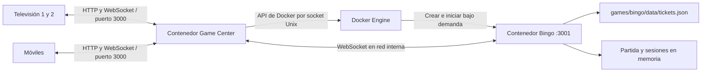

# Arquitectura

## Separación

- `server/`: centro siempre disponible, catálogo explícito, archivos públicos, pasarela WebSocket y ciclo de vida de contenedores. No contiene reglas de ningún juego.
- `games/bingo/domain/`: lógica autoritativa sin HTTP, Docker ni DOM; generador y validador de cartones.
- `games/bingo/server.mjs`: adaptación de WebSocket al dominio, límites de mensajes y detección de desconexión.
- `games/<id>/public/`: interfaz específica del juego. Su organización y decisiones se documentan en el README y `docs/` del propio juego.
- `games/bingo/data/`: catálogo privado. Nunca se sirve como ruta pública.
- `games/bingo/art/`: originales y documentación artística.
- `public/`: catálogo general, PWA y utilidades compartidas mínimas.
- `scripts/`: preparación reproducible de recursos y operaciones explícitas.

Un único Dockerfile genera una imagen compartida e inmutable. Compartir las capas ahorra disco; **el centro y cada juego se ejecutan en contenedores distintos**, con comandos y memoria independientes. No se utiliza Docker-in-Docker: el centro se comunica con Docker Desktop a través de `/var/run/docker.sock`.

El centro se conecta a dos redes: `access`, una red bridge que permite publicar su puerto al anfitrión, e `internal`, aislada del exterior. Los juegos solo se conectan a `internal`. Esto evita que `internal: true` impida la publicación del puerto en Docker Desktop.

## Ciclo de vida

`POST /api/games/bingo/launch` o la apertura de `/ws/bingo` activa un arranque. `GameManager` mantiene una única promesa por juego, inspecciona el contenedor, verifica su etiqueta de propietario y lo crea si falta. Espera su `/health` antes de responder.

Las conexiones pendientes reservan el juego para que el recolector no lo retire durante un arranque. El cierre por inactividad también tiene una promesa que serializa las entradas concurrentes. Se cuentan todas las conexiones, incluidas televisiones y visitantes en la elección de dispositivo. Al quedar vacío empieza el plazo de 24 horas. Una ventana abierta sigue contando como uso. Los pings WebSocket detectan conexiones perdidas en aproximadamente 15–30 segundos.

Al reiniciar el centro se adoptan contenedores etiquetados de su instancia. La partida del bingo sigue en su contenedor y los navegadores reconectan. El plazo de inactividad se reinicia conservadoramente desde ese momento; no se persiste el instante exacto del último uso. Si el juego falla, la pasarela invalida su arranque y el siguiente intento inspecciona y vuelve a iniciar su contenedor.

Los contenedores dinámicos no pertenecen a los servicios de Compose y `docker compose down` por sí solo no los retira. Utiliza la secuencia de apagado documentada en operación.

## Añadir otro juego

1. Crear `games/<id>/` con `server.mjs`, `domain/`, `public/`, `data/`, pruebas y README propios.
2. Implementar `/health` y WebSocket `/socket`. Escuchar en `0.0.0.0` usando el puerto configurado en el contenedor.
3. Añadir al registro `server/catalog.mjs` el identificador, textos, puerto y comando fijo. Nunca aceptar comandos o imágenes enviados desde el navegador.
4. Construir de nuevo la imagen con Compose. El contenedor del nuevo juego no se creará hasta que alguien entre.
5. Si necesita persistencia, añadir un volumen exclusivo y SQLite dentro de su carpeta de datos; actualmente los juegos son de solo lectura y habrá que declarar explícitamente ese volumen y su permiso.

Por ahora el diseño gráfico del catálogo está especializado en Bingo. Al añadir otro juego, incorporar su portada y metadatos visuales al componente del catálogo.

## Dependencias

Node.js 22, `ws` para transporte WebSocket, Three.js para el presentador opcional y Sharp únicamente para preparar imágenes. Fuentes Fredoka y Space Mono incluidas en la imagen, sin CDN. `package-lock.json` fija las dependencias transitivas y Docker utiliza `npm ci`.

Referencias técnicas: [Docker Engine API](https://docs.docker.com/reference/api/engine/), [ws](https://github.com/websockets/ws), [Three.js](https://threejs.org/docs/), [instalación PWA](https://developer.mozilla.org/en-US/docs/Web/Progressive_web_apps/Guides/Making_PWAs_installable).

Los artefactos temporales (artifacts/) y las fuentes de Blender (games/*/art/blender/) no se incluyen en la imagen del servidor. Las pruebas reutilizables se conservan en tests/; la vista manual del personaje solo la sirve la pasarela de pruebas, fuera de games/bingo/public/.
